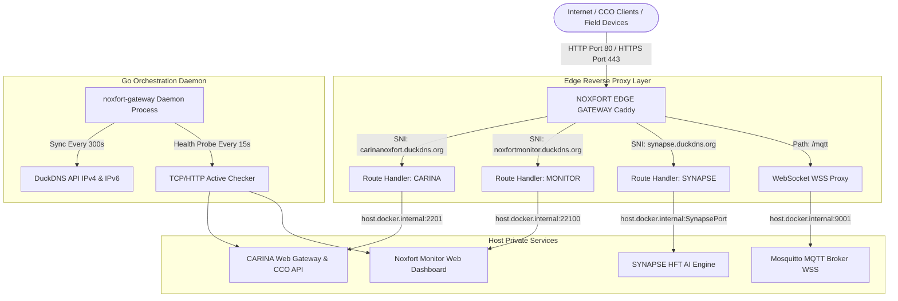
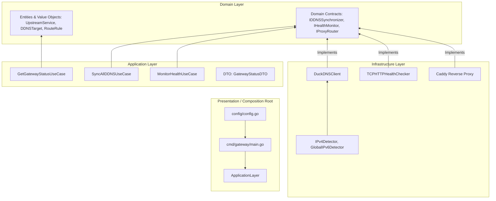
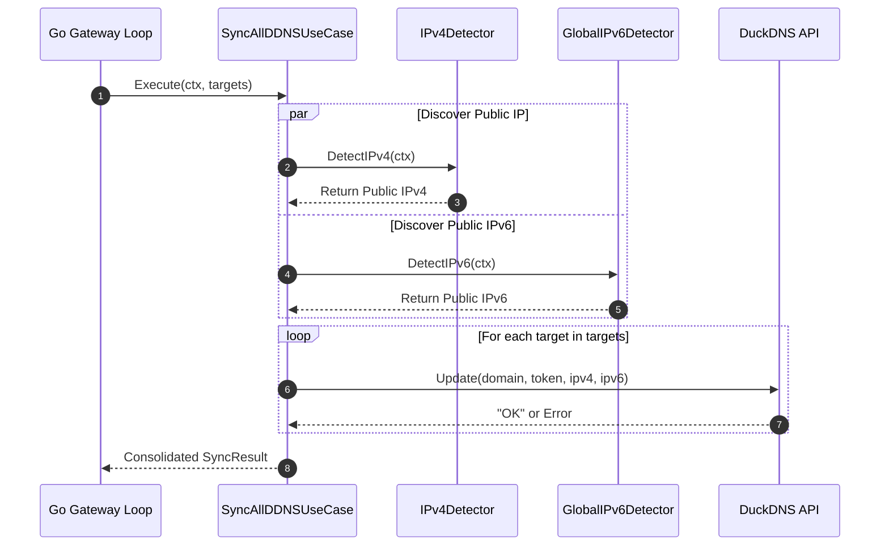

# 🏛️ NOXFORT EDGE GATEWAY: System Blueprint & Architecture

This document specifies the internal engineering architecture of **NOXFORT EDGE GATEWAY**. It details the Domain-Driven Design (DDD) Clean Architecture layers, the multi-tenant SNI ingress routing model, automated dual-stack Dynamic DNS (DuckDNS) synchronization, active health monitoring, and containerized deployment topology.

⬅️ Back to [Main Documentation Hub](docs/NOXFORT_EDGE_GATEWAY_MOC.md) | ⚡ See [API & Contracts](docs/API_REFERENCE.md) | 🌐 See [DDNS Synchronization](docs/DDNS_SYNCHRONIZATION.md) | 🛡️ See [Health Monitoring](docs/HEALTH_MONITORING.md)

---

## 1. Network Topology & Ingress Concurrency Model

In municipal traffic control centres (CCOs) and edge server nodes, multiple independent software platforms (CARINA Traffic AI, Noxfort Monitor, Synapse HFT) must coexist securely on the same host operating system without colliding on standard web ports.

The **NOXFORT EDGE GATEWAY** resolves this by seizing public TCP ports **80** (HTTP / ACME Challenge) and **443** (HTTPS / TLS SNI) through a custom Caddy container, multiplexing encrypted traffic directly to backend services running on loopback ports:

---

## 2. Clean Architecture & DDD Layering (Go)

The native Go orchestrator (`cmd/gateway/main.go`) is structured strictly according to Domain-Driven Design and Clean Architecture principles, ensuring that high-level enterprise business rules remain entirely agnostic of third-party frameworks, network drivers, or DNS providers.

### 2.1 Domain Layer (`internal/domain`)
- **Entities & Value Objects:**
  - `UpstreamService`: Represents a private backend target with mutable availability state (`StatusHealthy`, `StatusUnhealthy`, `StatusDegraded`), check latency, and consecutive failure counters.
  - `DDNSTarget`: Immutable Value Object holding the dynamic DNS registration parameters, public FQDN, DuckDNS token, and resolved IPv4/IPv6 addresses.
  - `RouteRule`: Represents an SNI routing configuration linking an external domain to a target service ID.
- **Contracts (`internal/domain/contracts`):**
  - `IDDNSSynchronizer`: Contract defining idempotent DNS update capabilities over IPv4/IPv6.
  - `IHealthMonitor`: Contract defining active probing mechanisms (TCP connect + HTTP GET).
  - `IProxyRouter`: Contract abstracting dynamic route reloading and Caddy admin API interactions.

### 2.2 Application Layer (`internal/application`)
- **Use Cases:**
  - `SyncAllDDNSUseCase`: Iterates through all configured DDNS targets, resolves external public IP addresses (IPv4 via `api.ipify.org` and IPv6 via local network interface inspection), and pushes updates to the DuckDNS API concurrently.
  - `MonitorHealthUseCase`: Dispatches parallel health checks against all registered upstream microservices, calculating latency and updating domain status.
  - `GetGatewayStatusUseCase`: Aggregates the operational health of all routes, DDNS synchronizations, and upstream services into a unified `GatewayStatusDTO`.

### 2.3 Infrastructure Layer (`internal/infrastructure`)
- **`ddns/`:**
  - `DuckDNSClient`: Implements `IDDNSSynchronizer`, communicating over HTTPS with `https://www.duckdns.org/update`.
  - `IPv4Detector`: Fetches public egress IPv4 using redundant public endpoints with strict timeouts.
  - `GlobalIPv6Detector`: Inspects local OS network interfaces (`net.Interfaces`) to identify valid public global unicast IPv6 addresses (excluding link-local `fe80::` and loopback `::1`).
- **`health/`:**
  - `TCPHTTPHealthChecker`: Performs a dual-phase verification: first validates raw TCP handshake on host:port, followed by an HTTP GET against the designated health endpoint (e.g., `/health`).
- **`caddy/`:**
  - Custom multi-stage `Dockerfile` building Caddy with `github.com/caddy-dns/duckdns`.
  - Dynamic `Caddyfile` managing multi-tenant SSL/TLS certificates and reverse proxy blocks.

---

## 3. Dynamic DNS Synchronization Workflow

---

## 4. High-Availability & Self-Healing Safeguards

1. **Atomic Health State Transitions:** Upstream services transition from `HEALTHY` to `UNHEALTHY` only after crossing the configured failure threshold, preventing flap anomalies during brief microservice restarts.
2. **Exponential Backoff on DDNS Outages:** When DuckDNS or external IP detector endpoints return network errors, the synchronization engine logs the incident and retries without crashing the daemon process.
3. **Caddy Zero-Downtime Hot Reloads:** Route updates and certificate renewals are processed in-memory via Caddy's internal Admin API (`localhost:2019`) without dropping active TLS connections.
4. **Docker Container Liveness:** Container health is supervised by Docker daemon with `restart: unless-stopped` policy.

---

   
  <b>Noxfort Systems</b> — <i>A State Of Art Company</i> 
  <small>© 2026 Noxfort Systems. Licensed under Apache-2.0 (SPDX: Apache-2.0).</small>

