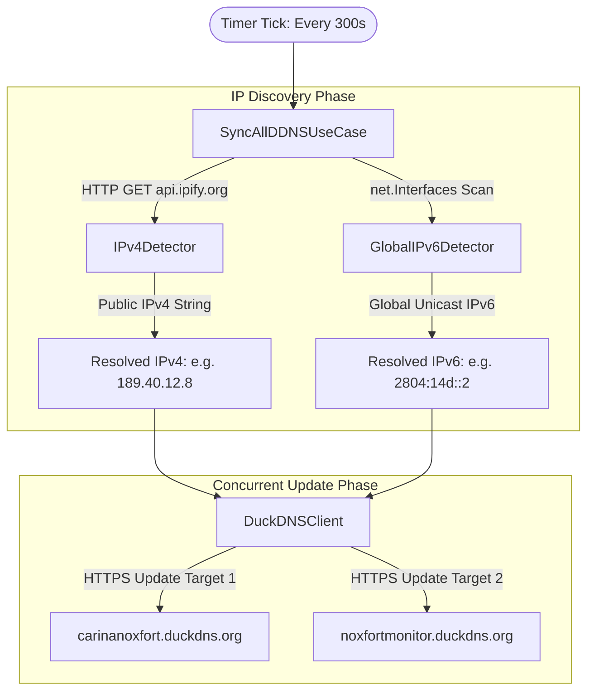

# 🌐 Dynamic DNS (DuckDNS) Synchronization Subsystem

This document provides in-depth technical documentation on the dual-stack Dynamic DNS (DuckDNS) synchronization engine in **NOXFORT EDGE GATEWAY**.

⬅️ Back to [Master Documentation Hub](NOXFORT_EDGE_GATEWAY_MOC.md) | 🏛️ See [Architecture](ARCHITECTURE.md) | ⚡ See [API & Contracts](API_REFERENCE.md)

---

## 1. Problem Statement & Motivation

Municipal traffic control centers (CCOs) and edge signal intersection servers often operate on enterprise WAN or cellular connections (4G/5G industrial modems) where:
1. **Public IPv4 is dynamic** or behind Carrier-Grade NAT (CGNAT).
2. **Native IPv6 is available** and globally routable to the physical machine.
3. Commercial static IP blocks are cost-prohibitive across hundreds of edge sites.

The **NOXFORT EDGE GATEWAY** solves this by running an asynchronous, periodic dual-stack DDNS daemon that continuously syncs both public IPv4 and global unicast IPv6 to registered subdomains.

---

## 2. Dual-Stack Discovery Architecture



### 2.1 Public IPv4 Detection (`IPv4Detector`)
- Contacts `https://api.ipify.org` over TLS with a strict 5-second HTTP client timeout.
- Validates that the returned payload conforms to valid IPv4 octet notation (`X.X.X.X`).
- Trims whitespace and handles edge-case newline responses.

### 2.2 Global IPv6 Detection (`GlobalIPv6Detector`)
- Uses Go's standard library `net.Interfaces()` to iterate over all active hardware network interfaces.
- Filters out down or loopback interfaces (`net.FlagUp`, `net.FlagLoopback`).
- Inspects assigned addresses using `ipNet.IP.IsGlobalUnicast()`.
- Explicitly rejects:
  - Link-local addresses (`fe80::/10`).
  - Unique Local Addresses (ULA `fc00::/7`).
  - Multicast (`ff00::/8`).
  - Loopback (`::1`).
- Selects the first public globally routeable IPv6 address found.

---

## 3. DuckDNS Client Implementation (`DuckDNSClient`)

The client encapsulates REST communication with the DuckDNS backend:

```go
func (c *DuckDNSClient) SyncTarget(ctx context.Context, target *models.DDNSTarget, ipv4, ipv6 string) (*contracts.SyncResult, error) {
    endpoint := fmt.Sprintf("%s/update?domains=%s&token=%s&ip=%s&ipv6=%s&verbose=true",
        c.baseURL,
        url.QueryEscape(target.Subdomain),
        url.QueryEscape(target.Token),
        url.QueryEscape(ipv4),
        url.QueryEscape(ipv6),
    )
    // Dispatches HTTP GET with context deadline...
}
```

### Idempotency & State Recording
When DuckDNS responds with `OK`, the domain entity is updated with:
- Current timestamp (`time.Now().UTC()`).
- Successfully bound IPv4 and IPv6 strings.
- Reset of consecutive failure counters.

---

## 4. Resilience & Error Handling

- **Transient Outages:** If the outbound internet connection is temporarily interrupted, the detector returns a descriptive error. The use case logs the failure without crashing the gateway.
- **Independent Failure Domains:** A failure in IPv6 discovery does not prevent IPv4 from updating, and vice versa.
- **Token Masking:** Authentication tokens are strictly sanitized in logs and runtime dumps to prevent credential leakage.

---

<div align="center">
  <br/>
  <b>Noxfort Systems</b> — <i>A State Of Art Company</i><br/>
  <small>© 2026 Noxfort Systems. Licensed under Apache-2.0 (SPDX: Apache-2.0).</small>
</div>
