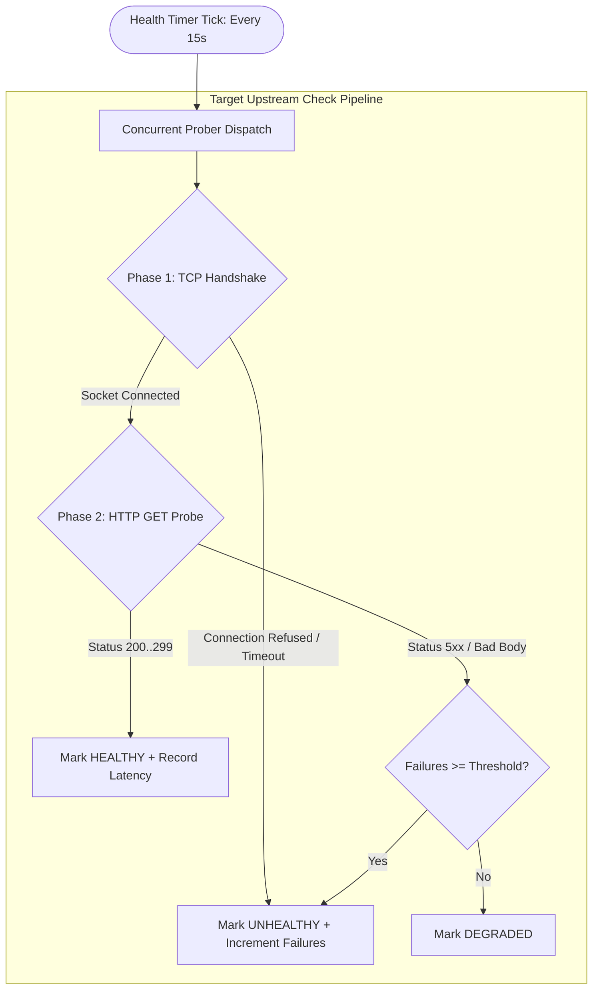
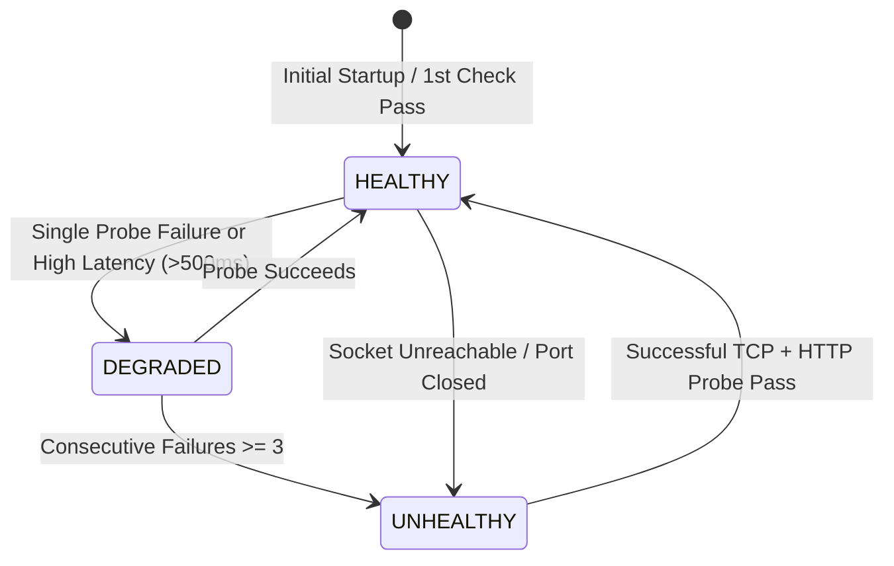

# 🛡️ Active Health Monitoring Subsystem

This document specifies the technical design, probing mechanics, and state machine of the active health monitoring engine in **NOXFORT EDGE GATEWAY**.

⬅️ Back to [Master Documentation Hub](NOXFORT_EDGE_GATEWAY_MOC.md) | 🏛️ See [Architecture](ARCHITECTURE.md) | ⚡ See [API & Contracts](API_REFERENCE.md)

---

## 1. Overview & Operational Philosophy

In edge deployment environments, a reverse proxy that blindly routes traffic to an unresponsive or frozen backend microservice causes connection timeouts and degrades CCO operations.

The **NOXFORT EDGE GATEWAY** integrates an active probing engine (`internal/infrastructure/health/tcp_http_checker.go` orchestrated by `MonitorHealthUseCase`) that polls internal upstream microservices on scheduled intervals (default: every 15 seconds) using a **two-phase verification pipeline**.

---

## 2. Two-Phase Verification Pipeline

### 2.1 Phase 1: Raw TCP Socket Handshake
- Executes `net.DialTimeout("tcp", targetAddress, 3*time.Second)`.
- Verifies that the host operating system has an active process listening on the designated private port (e.g. `127.0.0.1:2201` for CARINA).
- If the socket cannot be established (e.g., process crashed), Phase 2 is immediately skipped to prevent hanging HTTP timeouts.

### 2.2 Phase 2: HTTP Application Health Endpoint
- If Phase 1 succeeds and the upstream specifies an HTTP health path (e.g., `/health` or `/api/health`), the prober dispatches an HTTP GET request with a strict context deadline.
- Evaluates HTTP response status codes:
  - `200 OK` – `299`: Service is fully functional.
  - `500 Internal Server Error`, `503 Service Unavailable`: Service is executing but failing internally.

---

## 3. Availability State Machine

| State | Definition | Impact on Ingress |
| :--- | :--- | :--- |
| `HEALTHY` | Socket accessible, HTTP returns 200 OK, latency < 500ms. | Ingress routes traffic normally with zero restrictions. |
| `DEGRADED` | Intermittent probe failure or elevated latency. | Ingress maintains route, logs warning telemetry. |
| `UNHEALTHY` | 3 or more consecutive failed checks or socket closed. | Telemetry flags incident; prepares fail-safe maintenance page. |

---

## 4. Latency Calculation & Benchmarking

Every successful probe records real-time network and application execution latency:

$$\text{Latency} = t_{\text{response\_received}} - t_{\text{probe\_initiated}}$$

Since upstream services are hosted locally (`127.0.0.1` or `host.docker.internal`), typical response latencies range between **0.5 ms and 3.0 ms**. Persistent deviations beyond this threshold indicate CPU throttling or memory exhaustion on the host machine.

---

   
  <b>Noxfort Systems</b> — <i>A State Of Art Company</i> 
  <small>© 2026 Noxfort Systems. Licensed under Apache-2.0 (SPDX: Apache-2.0).</small>

