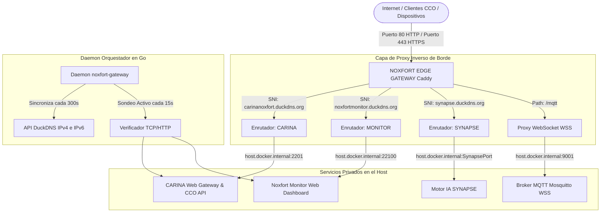

# 🏛️ Arquitectura del Sistema y Blueprint de Ingeniería

Este documento especifica la arquitectura interna de ingeniería de **NOXFORT EDGE GATEWAY**. Detalla las capas de Clean Architecture y Domain-Driven Design (DDD), el modelo de enrutamiento de entrada multi-tenant por SNI, la sincronización automatizada de DNS dinámico dual-stack (DuckDNS IPv4/IPv6) y la supervisión activa de estado.

⬅️ Volver al [Centro de Documentación](README.md) | ⚡ Ver [APIs y Contratos](api_reference.md)

---

## 1. Topología de Red y Modelo de Concurrencia

En los centros de control de tráfico municipal (CCO) y nodos de servidores de borde, múltiples plataformas independientes (CARINA Traffic AI, Noxfort Monitor, Synapse HFT) deben coexistir de forma segura en el mismo sistema operativo anfitrión sin colisionar en los puertos web estándar.

**NOXFORT EDGE GATEWAY** resuelve esto asumiendo los puertos TCP públicos **80** (HTTP) y **443** (HTTPS / TLS SNI) a través de un contenedor Caddy personalizado, multiplexando el tráfico cifrado directamente a los servicios backend que se ejecutan en puertos de bucle invertido locales:

---

## 2. Capas de Clean Architecture y DDD en Go

El orquestador nativo en Go está estructurado estrictamente según Domain-Driven Design y Clean Architecture:
- **Capa de Dominio (`internal/domain`):** Entidades puras (`UpstreamService`), objetos de valor (`DDNSTarget`, `RouteRule`) y contratos (`IDDNSSynchronizer`, `IHealthMonitor`, `IProxyRouter`).
- **Capa de Aplicación (`internal/application`):** Casos de uso (`SyncAllDDNSUseCase`, `MonitorHealthUseCase`, `GetGatewayStatusUseCase`) y DTOs limpios.
- **Capa de Infraestructura (`internal/infrastructure`):** Clientes HTTP (`DuckDNSClient`), detectores de IP pública/global e implementaciones de Caddy.

---

   
  <b>Noxfort Systems</b> — <i>A State Of Art Company</i> 
  <small>© 2026 Noxfort Systems. Licenciado bajo Apache-2.0 (SPDX: Apache-2.0).</small>

