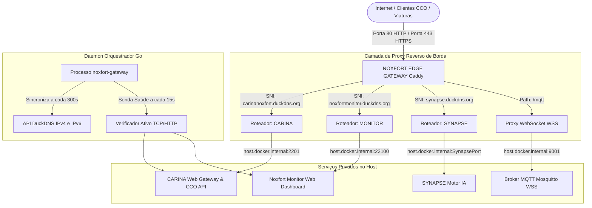
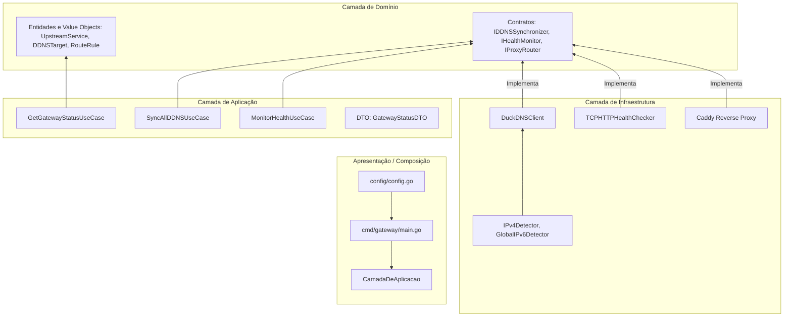

# 🏛️ Arquitetura do Sistema e Blueprint de Engenharia

Este documento especifica a arquitetura interna do **NOXFORT EDGE GATEWAY**. Ele detalha as camadas de Clean Architecture e Domain-Driven Design (DDD), a topologia de ingress multi-tenant por SNI, o sincronizador periódico de DNS dinâmico (DuckDNS) dual-stack e a infraestrutura de sondas ativas de integridade.

⬅️ Voltar para a [Central de Documentação](noxfort_edge_gateway_moc.md) | ⚡ Ver [APIs e Contratos](api_reference.md) | 🌐 Ver [Sincronização DDNS](ddns_synchronization.md)

---

## 1. Topologia de Rede e Modelo de Concorrência

Em centros de controle operacional (CCO) municipais e servidores de borda, diversos sistemas independentes (IA Semafórica CARINA, Noxfort Monitor, Synapse HFT) precisam operar simultaneamente sem colidir nas portas de rede padrão.

O **NOXFORT EDGE GATEWAY** atua como porteiro exclusivo das portas públicas **80** (HTTP) e **443** (HTTPS) por meio de um container Docker Caddy, roteando conexões criptografadas por SNI diretamente para as portas privadas locais:

---

## 2. Camadas Clean Architecture e DDD em Go

O orquestrador nativo em Go é estruturado rigorosamente sob Clean Architecture e DDD:

---

   
  <b>Noxfort Systems</b> — <i>A State Of Art Company</i> 
  <small>© 2026 Noxfort Systems. Licenciado sob Apache 2.0.</small>

